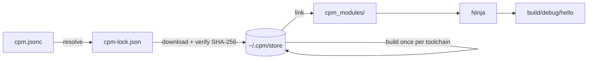

<div align="center">


# CPM

**The npm-style package manager and build system for C++**

One manifest. A lockfile. Dependencies built once and shared. No CMake.

[](https://github.com/meirborowski/CPM/actions/workflows/ci.yml)
[](https://github.com/meirborowski/CPM/releases/latest)
[](LICENSE)
[](https://cpm-registry.com)

[Install](#install) · [Quick start](#quick-start) · [Commands](#commands) · [Registry](#the-registry) · [Docs](docs/spec/README.md)

</div>

```sh
cpm init -y hello && cd hello
cpm install fmt
cpm run
```

## Why CPM?

- **📦 One file describes your project.** `cpm.jsonc` lists the name, the C++ standard and the dependencies. Sources are found by convention, and CPM writes Ninja files directly, so there's no CMake.
- **🔒 Reproducible by default.** `cpm-lock.json` pins every version, git commit and archive hash. Teammates and CI get exactly what you built.
- **⚡ Build dependencies once.** Each library is compiled once per toolchain and shared by every project on your machine.
- **🌐 A real registry.** Install from [cpm-registry.com](https://cpm-registry.com), and publish your own libraries after a GitHub sign-in.
- **🧰 Zero dependencies.** CPM is one self-contained binary of plain C++23, built with itself.

## Install

One command installs CPM and, if your machine doesn't have them yet, a C++ compiler and Ninja.

**Windows** (PowerShell)

```powershell
irm https://cpm-registry.com/install.ps1 | iex
```

**Linux** (x86-64) and **macOS** (Apple silicon, macOS 13.3+)

```sh
curl -fsSL https://cpm-registry.com/install.sh | sh
```

Open a new terminal afterwards so `cpm` is on your `PATH`, then try the [quick start](#quick-start).

The script puts `cpm` in `~/.cpm/bin` after checking its SHA-256 against the release, then runs **`cpm setup`**. That command looks for what CPM needs and says what it will change before it changes anything:

| Platform | What `cpm setup` installs when it's missing |
|---|---|
| Windows | [WinLibs](https://winlibs.com) GCC (MinGW-w64, UCRT) and [Ninja](https://ninja-build.org), into `~/.cpm/tools`. Nothing outside your user folder changes. |
| Linux | `g++` and `ninja-build` from your distribution, with `sudo`: apt, dnf, pacman, zypper or apk |
| macOS | Apple's Command Line Tools (Clang), plus Ninja into `~/.cpm/tools` |

Run `cpm setup --check` at any time to see what's there without changing anything. If you already have GCC 13+ or Clang 17+, Ninja 1.10+ and `git`, CPM uses those and installs nothing.

<details>
<summary>Install by hand</summary>

Download the binary for your platform from the [latest release](https://github.com/meirborowski/CPM/releases/latest), check it against `SHA256SUMS`, put it on your `PATH`, and run `cpm setup`.

The install scripts accept these environment variables:
- `CPM_HOME` installs somewhere other than `~/.cpm`.
- `CPM_NO_SETUP=1` skips `cpm setup`.
- `CPM_NO_MODIFY_PATH=1` leaves your `PATH`, `CPM_HOME` and shell profiles alone.

</details>

## Quick start

Create a project:

```sh
cpm init -y hello        # an executable; also --lib, --shared-lib, --header-only
cd hello
```

Add a library from the registry:

```sh
cpm install fmt
```

Use it in `src/main.cpp`:

```cpp
#include <fmt/format.h>

int main() {
    fmt::print("Hello from {}!\n", "CPM");
}
```

Build and run:

```sh
cpm run
# Hello from CPM!
```

`cpm install` added the dependency to `cpm.jsonc`. CPM edits the file in place and keeps your comments; the template `cpm init` writes explains every field. Trimmed down, it looks like this:

```jsonc
{
  "name": "hello",
  "version": "0.1.0",
  // The C++ standard this package, and everything built for it, is compiled with.
  "std": "c++23",
  "type": "executable",
  "dependencies": {
    "fmt": "^12.2.0"
  }
}
```

A project is just a manifest and a conventional layout:

```
hello/
├── cpm.jsonc            the manifest
├── cpm-lock.json        exact versions (commit it)
├── src/main.cpp         the entry point (src/lib.cpp makes a library)
├── src/*.cpp            everything else in src/ is compiled and linked in
└── tests/*.test.cpp     each one is a test program for `cpm test`
```

## Commands

| Command | What it does |
|---|---|
| `cpm setup [--check]` | Install a C++ compiler and Ninja if they're missing, or just report what's there |
| `cpm init [dir]` | Create a project: executable, static or shared library, or header-only |
| `cpm install <pkg>` (`i`, `add`) | Add dependencies: `fmt`, `fmt@^12`, `../mylib`, `git+https://…#v1.0` |
| `cpm install` | Install everything in `cpm.jsonc` exactly as `cpm-lock.json` says |
| `cpm update [pkg…]` (`up`) | Move dependencies to the newest versions their ranges allow |
| `cpm outdated` | List dependencies with newer versions: current, wanted by the range, and latest |
| `cpm tree` · `cpm why <pkg>` | Show the resolved dependencies as a tree, or what pulls a package in |
| `cpm remove <pkg>` (`rm`) | Remove dependencies |
| `cpm build [--release]` | Compile into `build/debug/` or `build/release/` |
| `cpm run [script] [-- args]` | Build and run the program, or run a script from `cpm.jsonc` |
| `cpm test [filter]` | Build and run the test programs in `tests/` |
| `cpm search <query>` | Find packages on the registry |
| `cpm info <pkg>[@<range>]` | Show a package on the registry: description, license, versions and dependencies |
| `cpm login` · `cpm logout` · `cpm whoami` | Sign in to the registry with GitHub |
| `cpm publish [--dry-run]` | Publish this library to the registry |
| `cpm yank <pkg>@<ver>` | Hide a published version from new installs |
| `cpm owner list\|add\|remove` | Manage who can publish a package |
| `cpm cache [clean]` | Show what's in `~/.cpm` and its size, or remove what no project uses |

Run `cpm <command> --help` for every option.

## The registry

[**cpm-registry.com**](https://cpm-registry.com) is CPM's default registry. Search it, read package pages, and copy install commands. To start with it holds [fmt](https://cpm-registry.com/package/fmt), [spdlog](https://cpm-registry.com/package/spdlog), [nlohmann-json](https://cpm-registry.com/package/nlohmann-json), [doctest](https://cpm-registry.com/package/doctest), [Catch2](https://cpm-registry.com/package/catch2) and [CLI11](https://cpm-registry.com/package/cli11).

**Publish your own library:**

```sh
cpm login                # sign in with GitHub, in the browser
cpm publish --dry-run    # see what would be published
cpm publish
```

CPM packs a reproducible source archive: the same files always give the same SHA-256. The registry checks it again before accepting it. Published versions never change; to withdraw a broken one, use `cpm yank`.

**Run a registry of your own.** A registry can be:
- a plain directory or static website: [static registries](docs/spec/registry.md);
- a full service like cpm-registry.com, whose source is [meirborowski/cpm-registry](https://github.com/meirborowski/cpm-registry) and runs on Cloudflare's free tier.

Point CPM at another registry in `~/.cpm/config.jsonc`:

```jsonc
{
  "registries": {
    "default": "https://cpm-registry.com/",
    "work": "https://registry.example.com/"
  }
}
```

## How it works



1. **Resolve.** Every package gets exactly one version, which avoids ODR violations. The choice is saved in `cpm-lock.json`. When the version ranges can't all be met, CPM explains why, step by step.
2. **Fetch.** Sources go into a global store, `~/.cpm/store`, checked against the hashes in the lockfile.
3. **Build once.** Each library is compiled once per *ABI fingerprint*: compiler, standard library, C++ standard, flags and platform. Every project with the same fingerprint reuses the result.
4. **Link.** `cpm_modules/` in your project points into the store, and CPM writes a `build.ninja` for your code.

## Configuration

| Setting | Where |
|---|---|
| Registries, compiler, Ninja path, colours | `~/.cpm/config.jsonc` (`%USERPROFILE%\.cpm\config.jsonc` on Windows) |
| Use another compiler | `CXX=clang++` or `--cxx clang++` |
| Move CPM's home (store, caches, sign-in) | `CPM_HOME` |
| Profiles, defines, per-platform settings | `cpm.jsonc` ([manifest reference](docs/spec/manifest.md)) |

## Status

CPM is young, at **v0.4**, and moving fast. Every change is tested on Windows (MinGW-w64 GCC), Linux (GCC and Clang) and macOS (Apple Clang), and the one-line installers are tested on fresh machines weekly and after each release.

**Works today:**
- executables, plus static, shared and header-only libraries, in C++11 to C++26;
- registry, git and path dependencies;
- a shared build cache, with prebuilt binaries when a registry offers them;
- publishing, searching the registry, and finding outdated dependencies;
- inspecting packages and dependency graphs (`cpm info`, `cpm tree`, `cpm why`), and cleaning the store (`cpm cache`);
- version conflicts explained step by step, by a PubGrub resolver;
- a one-command install that also sets up a compiler and Ninja.

**Next, on the [road to 0.5.0](ROADMAP.md):** version overrides, choosing the compiler, C libraries, prebuilt binaries from the registry, MSVC, symbol isolation and workspaces, in small releases from 0.4.3.

## Documentation

- [Specification](docs/spec/README.md): the manifest, dependencies, the lockfile, the store, ABI fingerprints, the build, the registry protocol and the CLI
- [Roadmap](ROADMAP.md): the releases planned up to 0.5.0
- [Architecture](docs/spec/architecture.md): CPM's design, modules and milestones
- [Changelog](CHANGELOG.md): what each release changed
- [Contributing](CONTRIBUTING.md): building CPM from source, the tests, and releases

## License

[MIT](LICENSE) © meirborowski
